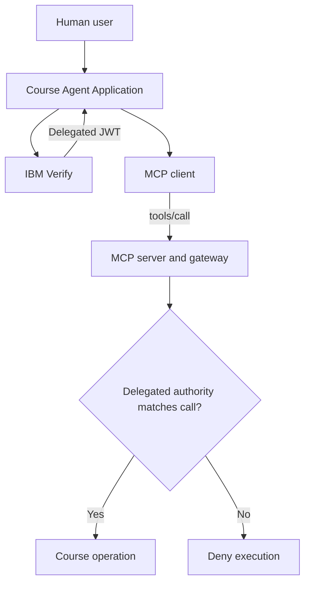

<!--
Copyright IBM Corp. All Rights Reserved.

SPDX-License-Identifier: Apache-2.0
-->

# UC2 architecture and identity flow

[README](../README.md) · [Setup](setup.md)

## What this sample solves

A course agent can select an MCP tool, but selection alone does not authorize execution. IBM Verify evaluates the human, agent and requested operation before issuing delegated authority. The MCP server then checks that authority against the actual tool call.

UC1 calls business tools directly. UC2 keeps the identity and delegation model and moves tool dispatch across the MCP client/server boundary. This additional boundary must validate the authorized tool name, course, user context, audience, scopes and agent identity.

## Components and responsibilities

| Component | Responsibility |
|---|---|
| Human user | Signs in and asks the agent to perform a course operation |
| Course Agent Application (`app.py`) | MCP host; holds the signed-in session, resolves intent, builds RAR, obtains tokens |
| MCP client (`mcp_client.py`) | Discovers and invokes server tools using `tools/list` and `tools/call` |
| MCP server (`mcp_server.py`) | Publishes tools and calls the protected gateway |
| Gateway (`mcp_gateway.py`) | Verifies delegated JWT, agent identity and operation context before execution |
| IBM Verify | Holds governed identities and application/policy configuration; authenticates and authorizes token issuance |
| Local course store | Returns fixture courses and persists enrollment writes in SQLite |
| Optional downstream Course API | Receives the delegated token only when forwarding is configured |

The registered agent is a governed identity in Verify; it does not execute Python. The running host uses credentials from the associated runtime OAuth application. The local MCP client starts the MCP server automatically as a STDIO subprocess using the same Python interpreter.

## Identity and token contract

| Artifact | Subject / actor identity | Purpose |
|---|---|---|
| Human ID token | Human `sub` | Establish validated browser identity; signature, issuer, audience and nonce checked |
| Human access token | Human `sub`; subject mapping permits `may_act.sub=AGENT_ID` | Input `subject_token` to Token Exchange; opaque or JWT supported |
| Actor access token | `sub=AGENT_ID`; `client_id=ACTOR_CLIENT_ID` | Authenticate the registered agent through Client Credentials |
| Delegated access token | Human `sub`, agent `act.sub=AGENT_ID` | Authorize one requested MCP operation for `course-mcp-server` |
| RAR `operationDetails.creator` | Runtime OAuth client ID | Identify the runtime application requesting the operation |

The AgentID is shown in **Identities → AI agents → your agent**. Enter it in the delegation mapping and local `AGENT_ID` setting as described in the setup guide.

## Runtime sequence

1. The host authenticates the human with Authorization Code + PKCE and validates the ID token.
2. The human asks for an operation; deterministic parsing or optional Gemini selects an allowed intent.
3. The host resolves the target and builds tool-specific `authorization_details`.
4. Client Credentials obtains a fresh actor token from the associated runtime application.
5. Token Exchange submits the human access token, actor token, RAR and `audience=course-mcp-server`.
6. Verify evaluates delegation and configured authorization mapping and issues a delegated JWT if allowed.
7. The MCP client invokes the selected tool with the delegated token and request context.
8. The server verifies the JWT and checks `act.sub=AGENT_ID`, audience, minimum scopes, tool/action/course and subject context before execution.
9. The host returns the result. An issued token alone does not prove the tool succeeded.

## Tool and scope contract

| Tool | Required scopes | Supplied mapping |
|---|---|---|
| `list_available_courses` | `mcp.tools.invoke course.read` | Grants both for an approved request |
| `list_enrolled_courses` | `mcp.tools.invoke course.read` | Grants both for an approved request |
| `enroll_course` | `mcp.tools.invoke course.enroll` | Grants both for an approved request |
| `delete_course_history` | `mcp.tools.invoke course.delete` | Grants only `mcp.tools.invoke`; intentional denial test |

Four tools are published in this working package. Discovery does not grant permission. The delete handler remains a negative test because the supplied mapping never grants `course.delete`.

## Local and remote boundaries

This tutorial uses local STDIO, not a remote HTTP MCP deployment. The normal path executes course logic locally (`MCP_FORWARD_TO_COURSE_API=false`). Forwarding additionally requires the downstream audience and resource configuration described in the setup. 

The app is a localhost lab. Before remote use, implement suitable server-side sessions, protected diagnostics and durable audit storage. Keep unsigned-token mode disabled for Verify testing.
