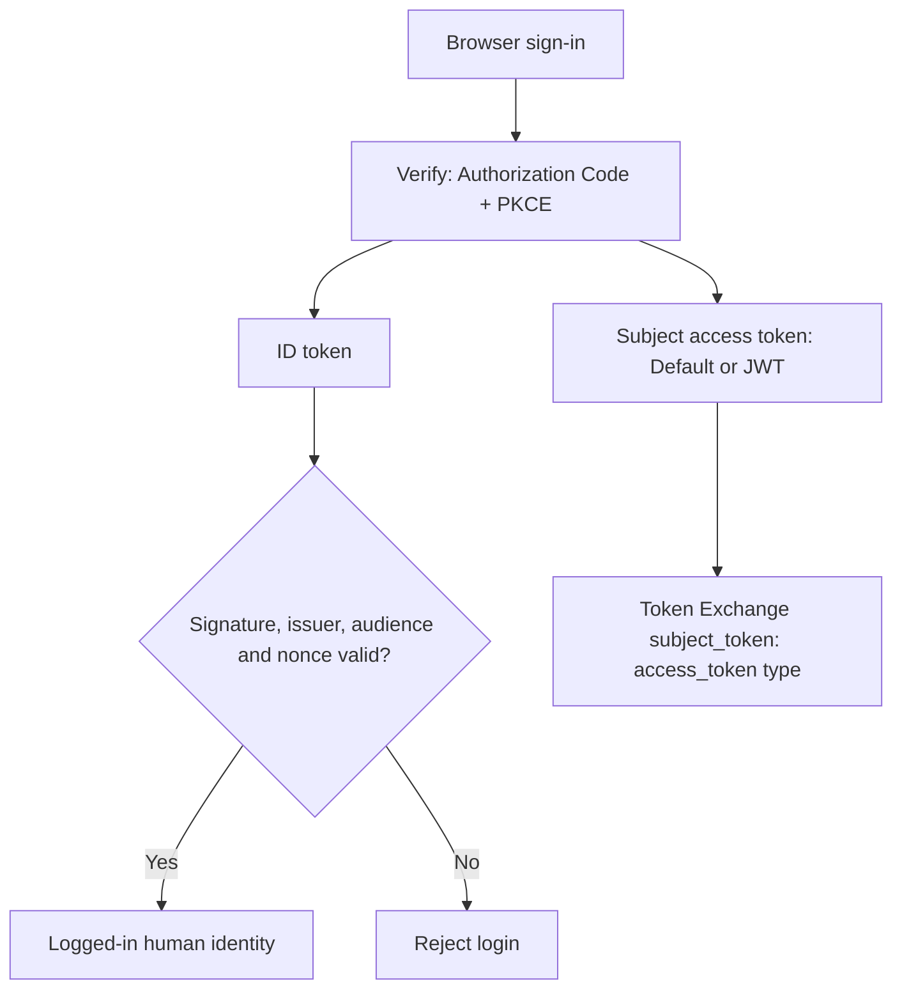

<!--
Copyright IBM Corp. All Rights Reserved.

SPDX-License-Identifier: Apache-2.0
-->

# Set up UC2: secure MCP tool calls with IBM Verify

[README](../README.md) · [Architecture](architecture.md) · [Postman and Insomnia](setup-and-api-walkthrough.md) · [Runtime checks](runtime-and-troubleshooting.md)

## Goal and execution path

Create a governed course agent, associate its runtime OAuth application, and let it call MCP tools on behalf of a signed-in human. Each step explains its purpose and the evidence needed before continuing.

Use the cURL commands below or the [direct cURL walkthrough](curl-walkthrough.md). Postman and Insomnia are alternatives described in the [API client walkthrough](setup-and-api-walkthrough.md). Both routes share the console configuration in Steps 4–6. Do not create the same objects again in each client. 

Run commands from the extracted project folder in a Bash or zsh terminal. Install curl, jq and Python 3.11–3.13. On macOS with Homebrew: `brew install jq python@3.11`.

Read the IBM Agent Identity concepts articles before starting.

### Applications used in this tutorial

| Application | Purpose |
|---|---|
| Human sign-in application | Sign in the user with Authorization Code + PKCE |
| Agent runtime OAuth application | Obtain the agent identity token using Client Credentials |
| UC2 Course MCP Agent Token Exchange | Obtain delegated access for the requested MCP operation |

## Step 1 — Prepare administrative access

**Why:** Setup calls need an administrative token with rights to create agents, register clients and associate an application.

**If omitted or incorrect:** An empty/expired token prevents API access; insufficient entitlements produce authorization errors such as HTTP 403 on the association PATCH.

Create an administrative API client in **Security → API access** (navigation labels can vary by tenant). Record its client ID and secret.

| Entitlement | API entitlement | Required for |
|---|---|---|
| Configure AI agents | `writeAgents` | Create/update the registry record |
| Review and manage AI agent status | `manageAgentStatus` | Activate/suspend the agent |
| Manage OIDC client registration dynamically | `manageOidcDynamicClient` | Register the runtime OAuth client |
| Manage application lifecycle | `manageAppAccessAdmin` | Associate the runtime application through PATCH |
| Manage authorization detail types | `manageAuthDetailTypes` | Register the ADT if it does not exist |
| Read all users but not group memberships | `readUsers` | Optional named-user directory lookup |

After adding entitlements, obtain a **new** administrative token. An existing token does not automatically gain the new permissions.

Load the setup helper in each new terminal session. It provides the `setup_request` and `setup_field` commands used below. Replace `<tenantname>` with your tenant hostname.

```bash
export TENANT='https://<tenantname>'
export ADMIN_CLIENT_ID='PASTE_ADMIN_API_CLIENT_ID'
export ADMIN_CLIENT_SECRET='PASTE_ADMIN_API_CLIENT_SECRET'
export TENANT="${TENANT%/}"
source curl/setup-session.sh

unset ADMIN_ACCESS_TOKEN
if setup_request 200 .local/admin-token.json \
  -X POST "$TENANT/oauth2/token" \
  -H 'Content-Type: application/x-www-form-urlencoded' \
  --data-urlencode 'grant_type=client_credentials' \
  --data-urlencode "client_id=$ADMIN_CLIENT_ID" \
  --data-urlencode "client_secret=$ADMIN_CLIENT_SECRET"; then
  if value=$(setup_field .local/admin-token.json access_token); then
    export ADMIN_ACCESS_TOKEN="$value"
    unset value
    printf 'Administrative token loaded.\n'
  fi
fi
```

**Completion check:** HTTP 200 and “Administrative token loaded.” Check presence with `printf 'Token length: %s\n' "${#ADMIN_ACCESS_TOKEN}"`; do not print the token. A 301 is a redirect, not success. The helper checks exact expected status codes, does not follow redirects, and saves bodies under `.local/`. Stop at any unexpected status before running the next block. A 401 at `/oauth2/token` calls for checking the administrative client credentials.

## Step 2 — Create the registry identity and runtime client

**Why:** The registry record supplies the durable AgentID; the OAuth client supplies replaceable credentials used to obtain an actor token.

**If omitted or incorrect:** The application cannot authenticate as the registered agent.

If these objects already exist, reuse their IDs and credentials. Otherwise run:

```bash
unset AGENT_ID
if setup_request 201 .local/agent-created.json \
  -X POST "$TENANT/v1.0/Agents" \
  -H "Authorization: Bearer $ADMIN_ACCESS_TOKEN" \
  -H 'Accept: application/scim+json' -H 'Content-Type: application/scim+json' \
  --data-binary @curl/payloads/course-mcp-agent.json; then
  if value=$(setup_field .local/agent-created.json id); then
    export AGENT_ID="$value"
    unset value
    jq '{id,displayName,status}' .local/agent-created.json
  fi
fi
```

Expected name: **UC2 Course MCP Conversational Agent**. Inspect the actual initial status; creation alone does not establish runtime readiness.

```bash
unset ACTOR_CLIENT_ID ACTOR_CLIENT_SECRET
if setup_request 201 .local/actor-created.json \
  -X POST "$TENANT/oauth2/register" \
  -H "Authorization: Bearer $ADMIN_ACCESS_TOKEN" \
  -H 'Content-Type: application/json' \
  --data-binary @curl/payloads/actor-client-dcr.json; then
  if client_id=$(setup_field .local/actor-created.json client_id) && \
     client_secret=$(setup_field .local/actor-created.json client_secret); then
    export ACTOR_CLIENT_ID="$client_id"
    export ACTOR_CLIENT_SECRET="$client_secret"
    unset client_id client_secret
    printf 'Runtime OAuth credentials loaded.\n'
  fi
fi
```

DCR must be enabled and permit the administrative bearer token. **Completion check:** both requests return 201, and nonempty `AGENT_ID`, `ACTOR_CLIENT_ID` and `ACTOR_CLIENT_SECRET` have been captured. These exports apply to this terminal; they do not populate the runtime `.env` automatically.

Retrieve only the created agent:

```bash
setup_request 200 .local/agent-current.json \
  "$TENANT/v1.0/Agents/$AGENT_ID" \
  -H "Authorization: Bearer $ADMIN_ACCESS_TOKEN" \
  -H 'Accept: application/scim+json' && \
  jq '{id,displayName,status,oauthClients}' .local/agent-current.json
```

The collection endpoint `/v1.0/Agents` lists tenant agents and may be paginated. It does not select the agent you just created.

## Step 3 — Associate and activate the agent

**Why:** Association tells Verify that this OAuth application authenticates the registered agent; activation establishes the required lifecycle state.

**If omitted or incorrect:** The runtime token may not represent the expected AgentID, or fresh runtime access may be denied by lifecycle controls.

### Find the application ID

1. Open **Applications → Applications** in the Verify administration console.
2. Open **UC2 Course MCP Conversational Agent**.
3. Confirm its OAuth client ID matches the `ACTOR_CLIENT_ID` returned in Step 2.
4. Copy the application ID from the application's details or the browser address. In a management route containing `/applications/7201665295314100044`, the application ID is `7201665295314100044`. The surrounding console route may vary.
5. Set `ACTOR_APPLICATION_ID` to the copied value below.

Use the ID of the application management record for this PATCH request.

```bash
export ACTOR_APPLICATION_ID='PASTE_RUNTIME_APPLICATION_MANAGEMENT_ID'
jq --arg agent_id "$AGENT_ID" \
  'map(if .path == "/providers/oidc/properties" then .value.entityId = $agent_id else . end)' \
  curl/payloads/actor-application-associate.json > .local/actor-associate.json

setup_request 204 .local/association-response.json \
  -X PATCH "$TENANT/v1.0/applications/$ACTOR_APPLICATION_ID" \
  -H "Authorization: Bearer $ADMIN_ACCESS_TOKEN" \
  -H 'Content-Type: application/json-patch+json' \
  --data-binary @.local/actor-associate.json
```

The payload sets `purpose=agent_id` and associates `entityType=agent`, `entityId=AGENT_ID`. **HTTP 204 with no body is success.** The `replace` operation replaces application tags; preserve any other tags on an existing customized application. The IBM API uses `path: "tags"` for this operation. Do not send this application PATCH payload to DCR PUT.

Open **Identities → AI agents → your agent → Identity & authentication** and verify the application association. Activate using:

```bash
setup_request 200 .local/agent-activated.json \
  -X PUT "$TENANT/v1.0/Agents/$AGENT_ID" \
  -H "Authorization: Bearer $ADMIN_ACCESS_TOKEN" \
  -H 'Accept: application/scim+json' -H 'Content-Type: application/scim+json' \
  --data-binary @curl/payloads/course-mcp-agent-activate.json

setup_request 200 .local/agent-current.json \
  "$TENANT/v1.0/Agents/$AGENT_ID" \
  -H "Authorization: Bearer $ADMIN_ACCESS_TOKEN" \
  -H 'Accept: application/scim+json' && \
  jq '{id,displayName,status,oauthClients}' .local/agent-current.json
```

**Completion check:** the agent is `ACTIVE` and its runtime application is listed under **Identity & authentication**. Preserve custom metadata when adapting the sample lifecycle payloads.

## Step 4 — Configure the human subject application

**Why**: The human subject application authenticates the user who interacts with the Course Agent. han relying on an application previously created for UC1.

4.1 Create the UC2 subject application

1. Sign in to the IBM Verify administration console.
2. Navigate to Applications.
3. Select **Add application**.
4. Choose OpenID Connect (OIDC).

Create the application using the following configuration.

| Setting | Sample value |
|---|---|
| Application name | **Course MCP Subject Application** |
| Grant | Authorization Code |
| Application URL | http://localhost:8000/ |
| PKCE | S256 / required |
| Redirect URI | `http://localhost:8000/callback` |
| OIDC scopes,Add under Custom scopes and API access | `openid profile email` |
| Subject access-token format | **Default (opaque) is supported; JWT is optional** |

Capture:
```text
SUBJECT_CLIENT_ID=<subject client ID>
SUBJECT_CLIENT_SECRET=<subject client secret>
``` 

### Human identity comes from the ID token

The browser login deliberately separates **identity** from the OAuth access token:



The application does **not** decode the subject access token to decide who logged in.
Therefore the subject application works whether its access token is JWT-formatted or opaque.
The access token is still sent to Token Exchange as:

```text
subject_token_type=urn:ietf:params:oauth:token-type:access_token
```

`verify_oauth.py` sends an OIDC `nonce` on the authorization request. `app.py` validates the returned `id_token` through `verify_id_token()` and stores only the access token plus validated ID-token claims in the browser session.


### Allow the agent to act for the user

The subject token represents the signed-in human user. During token exchange, IBM Verify must also validate whether the agent represented by the actor token is permitted to act on behalf of that user.

This sample uses the OAuth may_act relationship for this validation.

1. Open the **Introspect** endpoint configuration.
2. Add an introspection attribute mapping.
3. Select **Custom rule** as the source.
4. In the custom rule, enter:

   ```json
   {
     "sub": "<registry-agent-id>"
   }
   ```

   Use the **AgentID** returned in Step 2. You can also find it under **Identities → AI agents → your agent**.

5. Set the **Target attribute** to:

   ```text
   may_act
   ```

6. Save the mapping.


The resulting delegation mapping is:

```json
{
  "may_act": {
    "sub": "<registry-agent-id>"
  }
}
```
This mapping allows the selected agent to act on behalf of the signed-in user.


### Application entitlements

After completing the Sign-on configuration, configure who is allowed to access the application.

1. Open the **Entitlements** tab for `Course MCP Subject Application `.
2. Select:

   **All users are entitled to this application**

3. Save the configuration.

This tutorial uses **All users are entitled to this application** so that the test human user can sign in to the Course MCP Agent Application without requiring an additional user or group assignment.

> **Why is this required?**  

> Creating the OIDC application and enabling the Authorization Code grant does not by itself grant users access to the application. IBM Verify also evaluates the application's entitlement configuration during sign-in. If the signed-in user is not entitled to the application, authentication fails with an error similar to:
>
> ```text
> Only entitled users can single sign-on to the application.
> ```
>
> For this tutorial, allowing all users keeps the setup simple. In a production deployment, access should normally be restricted to the users or groups that are authorized to use the application.


Keep **Skip default actor validation** disabled on the Token Exchange client for this `may_act` setup. Actor Criteria is an alternative configuration, not an additional requirement: if your tenant uses it instead, configure an explicit allow rule before skipping the default check. See [Actor criteria](https://www.ibm.com/docs/en/security-verify?topic=clients-actor-criteria).

## Step 5 — Create the MCP Authorization Details Type

**Why:** Define the structure of the exact tool operation that Verify will evaluate and carry into the delegated token.

**If omitted or incorrect:** A missing or incompatible type can reject `authorization_details` before tool execution.

**Completion check:** The registered schema accepts `courseId` and every `operationDetails` field built by this package.

The sample uses:

```text
urn:ibm:demo:verify:mcp_tool_action
```

Use the exact schema in:

```text
payloads/mcp_tool_action_adt_schema.json
```

The actual `rar_builder.py` payload is shaped like:

```json
[
  {
    "type": "urn:ibm:demo:verify:mcp_tool_action",
    "courseId": "SEC-301",
    "operationDetails": {
      "creator": "<registry-agent-id>",
      "affectedPerson": "<target-subject>",
      "loggedInSubject": "<signed-in-subject>",
      "action": "enroll_course",
      "targetSystem": "course-mcp-server",
      "resource": "mcp-tool",
      "toolName": "enroll_course",
      "downstreamSystem": "course-api"
    }
  }
]
```

The schema included with this package matches these fields exactly.

**Agent identity:** `operationDetails.creator` is the permanent Verify Agent Registry `AGENT_ID`, not the OAuth `ACTOR_CLIENT_ID`. The delegated JWT must have `act.sub=AGENT_ID`. The runtime OAuth client ID continues to be used for client authentication.

**UC1/UC2 independence:** UC1 uses `urn:ibm:demo:verify:agent_action`; UC2 uses `urn:ibm:demo:verify:mcp_tool_action`. Register and authorize the UC2 type independently. Changing the runtime string does not register it in Verify or automatically grant entitlement/policy approval.


For this version, the ADT action and `toolName` enums contain four recognized intents:

```text
list_available_courses
list_enrolled_courses
enroll_course
delete_course_history
```

`delete_course_history` is registered as a real MCP tool for the **scope-denial test**. The supplied Verify mapping grants only `mcp.tools.invoke`; the gateway additionally requires `course.delete`, so the published handler is denied before execution.

### Register the ADT with cURL, Postman, Insomnia, or UI

Use UC2's schema, which includes `toolName`, `targetSystem=course-mcp-server`, `resource=mcp-tool`, and `downstreamSystem`. UC2 deliberately uses a distinct type from UC1 (`urn:ibm:demo:verify:agent_action`). Do not rename, delete, or modify the UC1 type. If the UC2 MCP type already exists, inspect its schema and update it only if required; avoid duplicate registration.

```bash
# Use 201 for the documented ADT creation response; inspect an unexpected status.
setup_request 201 .local/adt-created.json \
  -X POST "$TENANT/v1.0/auth-detail-types" \
  -H "Authorization: Bearer $ADMIN_ACCESS_TOKEN" \
  -H 'Content-Type: application/json' \
  --data-binary @payloads/mcp_tool_action_adt_registration.json
```

In Postman or Insomnia, run **09 Register MCP ADT** only if the type does not exist.

### Why `toolName` matters

The token-exchange request is created **before** the MCP tool call. The authorization detail says:

```text
toolName = enroll_course
```

Later, the MCP client performs:

```python
await session.call_tool("enroll_course", arguments)
```

At the MCP server boundary, `mcp_gateway.py` compares the actual tool invocation with the authorized operation context.

The sample is designed to deny this mismatch:

```text
authorization_details.toolName = list_available_courses
actual MCP tools/call name      = enroll_course
```

Tool discovery therefore does not grant permission to reuse a delegated token for a different tool.

## Step 6 — Configure the Token Exchange application

**Why:** Exchange the human and agent tokens for a JWT limited to the approved MCP operation and audience.

**If omitted or incorrect:** Wrong output format, missing entitlements, delegation settings or consent mapping prevents issuance or causes resource validation to fail.

**Completion check:** An allowed list operation issues a JWT for `course-mcp-server` with `mcp.tools.invoke course.read`, the approved authorization details and `act.sub=AGENT_ID`.

Create an OpenID Connect application with the Token Exchange grant.


The application sends:

```text
grant_type          = urn:ietf:params:oauth:grant-type:token-exchange
subject_token        = human access token (JWT or opaque)
subject_token_type   = urn:ietf:params:oauth:token-type:access_token
actor_token          = AI agent access token
actor_token_type     = urn:ietf:params:oauth:token-type:access_token
audience             = course-mcp-server
authorization_details = MCP tool invocation context
```

**There is no hard-coded `scope=` parameter in the Token Exchange request.** The delegated scopes are derived by IBM Verify from the authorization detail that is actually granted.

### Create the Token Exchange application

1. Open **Applications → Add application → OpenID Connect** and name it `UC2 Course MCP Agent Token Exchange`; complete the company name.
2. Under **Sign-on configuration**, enable **Token Exchange** and require an actor token.
3. Set subject and actor token types to `urn:ietf:params:oauth:token-type:access_token`.
4. Under token settings, select **JWT** for the **delegated output access token**, and set audience to `course-mcp-server`. This output format is distinct from the human subject access-token format.
5. Permit `mcp.tools.invoke`, `course.read`, and `course.enroll`, and attach the ADT from Step 5.
6. Leave **Skip default actor validation** disabled for the Step 4 `may_act` configuration.
7. Open **Endpoint configuration → Token → Consent request → Edit** and paste the UC2 mapping below.
8. Save the application and record its credentials as `STS_CLIENT_ID` and `STS_CLIENT_SECRET`. These are the configuration keys used by the application for Token Exchange.

### Allow users to use the application

1. Open the **Entitlements** tab of **UC2 Course MCP Agent Token Exchange**.
2. Select **All users are entitled to this application** for this tutorial.
3. Save.

This lets the test user use the Token Exchange application. For a restricted deployment, assign the intended users or groups.

### Associate the application with the agent's OBO task

1. Open **Identities → AI agents → your agent → Edit**.
2. Open **Agent tasks** and select **Act on behalf of a user**.
3. Select **UC2 Course MCP Agent Token Exchange** and save.
4. Reopen the agent and confirm both associations:

| Purpose | Application |
|---|---|
| Generate agent identity token | UC2 Course MCP Conversational Agent |
| Act on behalf of a user | UC2 Course MCP Agent Token Exchange |

The runtime application provides the agent's identity. The Token Exchange application handles delegated access for its user-facing task. Confirm that the agent remains **ACTIVE** after saving.

Postman and Insomnia exercise Token Exchange after this UI configuration. Configure the subject/Token Exchange applications, consent rule and user entitlements in the console; the supplied collections do not provision those settings.

Configure the Token Exchange authorization-details mapping with the following rule:

```yaml
statements:
  - context: >
      authzDetails := has(requestContext.authorization_details)
      ? requestContext.authorization_details.map(x,
          {
            "purpose": x.type,
            "attribute": x.operationDetails.resource,
            "accessType": x.operationDetails.action,
            "value": x.courseId,
            "scope":
              x.operationDetails.action == "list_available_courses"
              ? "mcp.tools.invoke course.read"
              : x.operationDetails.action == "list_enrolled_courses"
                ? "mcp.tools.invoke course.read"
                : x.operationDetails.action == "enroll_course"
                  ? "mcp.tools.invoke course.enroll"
                  : x.operationDetails.action == "delete_course_history"
                    ? "mcp.tools.invoke"
                    : "",
            "tokenClaims": {
              "authorization_details": [x]
            }
          })
      : []

  - return: context.authzDetails
```

This gives the delegated token exactly the authority associated with the approved action:

| ADT action | Scope populated by Token Exchange |
|---|---|
| `list_available_courses` | `mcp.tools.invoke course.read` |
| `list_enrolled_courses` | `mcp.tools.invoke course.read` |
| `enroll_course` | `mcp.tools.invoke course.enroll` |
| `delete_course_history` | `mcp.tools.invoke` only |

The protected boundary requires `mcp.tools.invoke` plus the business scope for each of the four tools. The delete handler requires `course.delete`, but the supplied Token Exchange mapping never grants it. Keep `course.delete` out of the Token Exchange permitted scopes for this negative test.

Capture:

```text
# Token Exchange application settings.
# Keep the STS_* variable names; the application reads these keys.
STS_CLIENT_ID=<token-exchange-client-id>
STS_CLIENT_SECRET=<token-exchange-client-secret>
```


Add resource/audience

This sample asks IBM Verify to issue the delegated token for:

```text
course-mcp-server
```

The Token Exchange client must be configured to permit the scopes that the authorization-details mapping can produce:

```text
mcp.tools.invoke
course.read
course.enroll
```

The application does not request that broad set. The rule above chooses the minimum output scope for each granted ADT action.


## Step 7 — Configure the application

**Why:** Connect the local runtime to the identities and applications configured above.

**If omitted or incorrect:** A missing or wrong `AGENT_ID` fails the local actor check even if Verify issued a valid token.

**Completion check:** `AGENT_ID` contains the ID from the agent details, and all application credentials have been entered.

For a fresh local configuration:

```bash
cp .env.example .env
python -c 'import secrets; print(secrets.token_urlsafe(32))'
```

Use the generated value for `SESSION_SECRET`. Set `AGENT_ID` to the ID returned in Step 2 or shown in the agent details.

Populate:

```dotenv
APP_BASE_URL=http://localhost:8000
SESSION_SECRET=<random-local-session-secret>

USE_LLM=false
GEMINI_API_KEY=
GEMINI_MODEL=gemini-2.5-flash

VERIFY_ISSUER=https://<tenant>/oauth2
VERIFY_AUTHORIZATION_ENDPOINT=https://<tenant>/oauth2/authorize
VERIFY_TOKEN_ENDPOINT=https://<tenant>/oauth2/token
VERIFY_JWKS_URI=https://<tenant>/oauth2/jwks
VERIFY_INTROSPECTION_ENDPOINT=https://<tenant>/oauth2/introspect

SUBJECT_CLIENT_ID=<subject-client-id>
SUBJECT_CLIENT_SECRET=<subject-client-secret>
SUBJECT_REDIRECT_URI=http://localhost:8000/callback
SUBJECT_SCOPES=openid profile email

AGENT_ID=<registry-agent-id>
ACTOR_CLIENT_ID=<dcr-created-actor-client-id>
ACTOR_CLIENT_SECRET=<dcr-created-actor-client-secret>
ACTOR_SCOPES=agent.run

# Token Exchange application settings.
# Keep the STS_* variable names; the application reads these keys.
STS_CLIENT_ID=<token-exchange-client-id>
STS_CLIENT_SECRET=<token-exchange-client-secret>
STS_AUDIENCE=course-mcp-server

MCP_AUDIENCE=course-mcp-server
MCP_SERVER_NAME=course-mcp-server
DOWNSTREAM_SYSTEM=course-api
MCP_FORWARD_TO_COURSE_API=false
COURSE_API_AUDIENCE=course-api

AGENT_ADT_TYPE=urn:ibm:demo:verify:mcp_tool_action
```

Confirm the Token Exchange application and its associated authorization, scope mapping, and policy are configured for the UC2 MCP ADT. Verify the registration before testing; an unknown ADT can cause a Token Exchange rejection.

For the first run:

```dotenv
USE_LLM=false
```

After the complete IBM Verify and MCP flow works, enable Gemini.

## Step 8 — Install and run

**Why:** Run the host and its MCP subprocess from the same project and Python environment.

**If omitted or incorrect:** Running an older checkout or process can retain the old client-ID comparison.

**Completion check:** Health and tool discovery work, followed by a successful authorized course request.

Check that `python3` points to Python 3.11–3.13 before creating the virtual environment:

```bash
python3 --version
python3 -m venv .venv
source .venv/bin/activate
python -m pip install --upgrade pip
pip install -r requirements.txt

python -m uvicorn app:app --host 127.0.0.1 --port 8000
```

The application validates ID-token signatures using the tenant JWKS.

Open:

```text
http://localhost:8000
```

The MCP server is **not started manually for the basic sample**. `mcp_client.py` launches `mcp_server.py` through `StdioServerParameters` when it establishes the MCP session.


After filling `.env`, confirm the settings:

```bash
python -c 'from config import settings; print("AGENT_ID:", settings.agent_id); print("ACTOR_CLIENT_ID:", settings.actor_client_id)'
python tools/diagnose_runtime.py
```

Stop and restart uvicorn after `.env` changes, then sign out and sign in again. A shell variable overrides the same `.env` key; use `unset AGENT_ID` if an old exported value is present. Finish with the [runtime tests and audit checks](runtime-and-troubleshooting.md).

## References

- [Application association PATCH and entitlement](https://docs.verify.ibm.com/verify/reference/patchapplication)
- [Create an agent](https://docs.verify.ibm.com/verify/reference/post_v1-0-agents)
- [Replace an agent](https://docs.verify.ibm.com/verify/reference/put_v1-0-agents-id)
- [Dynamic client registration](https://docs.verify.ibm.com/verify/reference/post_oauth2-register)
- [Create an authorization detail type](https://docs.verify.ibm.com/verify/reference/createauthdetailtype)
- [Actor Criteria](https://www.ibm.com/docs/en/security-verify?topic=clients-actor-criteria)

The optional ADT registration request uses the current documented `/v1.0/auth-detail-types` endpoint consistently in cURL, Postman and Insomnia. If an existing type is already in use, retain it and inspect/merge the schema instead of recreating it. 
